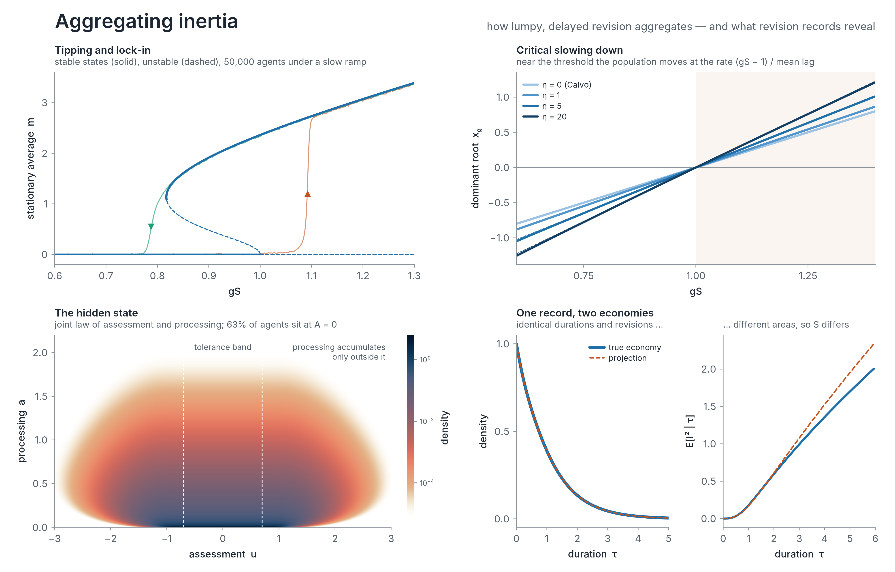

# Aggregating Inertia — computations

<picture>
  <source media="(prefers-color-scheme: dark)" srcset="figures/dark/00_hero.png">
  
</picture>

Every number, table and figure of

> Gabriel L. S. Bontemps, **Aggregating Inertia: Tipping, Slow Shifts and What Revision Records Reveal**, working paper, 2026
> ([SSRN](https://papers.ssrn.com/sol3/papers.cfm?abstract_id=6019456)),

computed by a numerical engine written in **Rust**, drawn with **Julia** (Makie), and packaged with **Docker**. The
paper's own figures (TikZ and PGFPlots) are rebuilt from the engine's output as well.

Households, forecasters and firms revise their plans in occasional lumps while their views drift, fade towards an
anchor and absorb what others think. The paper shows how this inertia aggregates — where consensus breaks, how fast
behaviour moves near the tipping point, whether the shift is gradual or abrupt — and what records of when and how much
people revise can and cannot reveal. This repository computes all of it.

## Run it

With Docker (nothing else needed):

```sh
docker build -t aggregating-inertia .
docker run --rm -v "$PWD/figures:/work/figures" aggregating-inertia figures            # figures from the stored results (minutes)
docker run --rm -v "$PWD/output:/work/output" -v "$PWD/figures:/work/figures" aggregating-inertia   # everything from scratch
```

Natively (tested with Rust 1.95 and Julia 1.12):

```sh
make engine         # cargo build --release
make data           # every computation -> output/   (about 70 minutes on two cores)
make figures        # the Julia figures -> figures/light, figures/dark   (PDF and PNG)
make paper-figures  # the paper's six figures as printed -> figures/paper   (needs pdflatex with PGFPlots)
make check          # compare output/ with the reference pipeline's results
```

Stages can be run separately: `inertia research grid`, `inertia validate mc`, `inertia figures`, `inertia tables`,
`inertia extras` (`inertia --help` lists them).

## What is computed

| Paper | Engine | Output |
|---|---|---|
| Figure 1 (one episode under a pausing clock) | `pipeline::figures::episode` | `data/episode_*.csv` |
| Figures 2 and 3 (an episode with resets; killing and reinjection) | none: schematics drawn by hand in TikZ | `paper/figures/trajectory.tex`, `reinjection.tex` |
| Figure 4 (kernels, Nyquist curves, dominant roots, bifurcation diagrams) | `stationary`, `ghf`, `pipeline::figures::{stability, tipping}` | `data/stab_*.csv`, `data/tip_*.csv` |
| Figure 5 (one record, two economies) | `episode` (economy B and its Markovian projection P) | `data/record_*.csv` |
| Figure 6 and Section 5 (what the record misses: location, speed, kurtosis statistic) | `episode::run::full_point`, `episode::speed` | `data/grid/grid_lam*.json`, `variant_*.json`, `speed_grid.json` |
| Conjecture 1 evidence (360 economies, unimodality) | `pipeline::research::{scans, unimodality}` | `data/grid/scan_*.jsonl`, `unimodality.json` |
| Supplement S1.4 (validation of both solvers, Monte Carlo) | `pipeline::validation`, `mc` | `data/validation/*.json` |
| Table S1.1 | `pipeline::tables` | `tex/variants.tex` |
| Every number quoted in the text | `pipeline::{figures, tables}` | `tex/values.tex`, `tex/tipping_values.tex`, `tex/validation_values.tex` |

`make paper-figures` compiles the paper's figure sources (`paper/figures`, unchanged) against `output/`.

The engine has three solvers and a Monte Carlo module:

- **Episode solver** (`rust/src/episode`): one reassessment episode of the true economy, with the processing clock
  on an (assessment, processing) grid, by finite volumes and backward Euler (a block-triangular sweep), and of its Markovian projection
  with the tabulated completion intensity; S_B and S_P two ways each, the area moments, extrapolation in the time step,
  the clock grid and the cell width.
- **Stationary solver** (`rust/src/stationary`): the forward generator of the population on (u, a) with killing at
  completions and reinjection at the reset, split into even and odd sectors; direct solves by block marching and a
  Woodbury capacitance matrix; the response kernel k(t), its Laplace transform, the Nyquist curve, the spectral gap
  (shift-invert Arnoldi) and an argument-principle certificate for the number of unstable roots.
- **One-dimensional solver** (`rust/src/ghf.rs`) for Markov completion rules: branches of stationary states, folds,
  hysteresis.
- **Monte Carlo** (`rust/src/mc`): the episode benchmark with the generator and the per-path streams of the
  reference C code, the coupled simulation of the kernel, the fluctuation–response identity and the perturbation formula.

## How it was checked

The engine is a port of the Python and C pipeline that produced the paper (kept in `reference/`). The two were
compared at every level:

- **Solvers, side by side** (`make crosscheck`): on the same grids, the Rust and reference solvers agree to
  4·10⁻¹⁴ relative (episode solver, with the same step counts and the same projected hazard), to 9·10⁻¹³
  (stationary solver, with the same Arnoldi spectral gap to 4·10⁻¹³, the same number of Nyquist evaluations and the
  same certified root count) and to 10⁻¹³ (one-dimensional solver; kernel values below 10⁻⁸ to 2·10⁻¹⁵ in absolute
  terms). The Monte Carlo reproduces the reference paths to 10⁻¹⁵, with the same random streams.
- **Figure data and macros**: from the reference research outputs, the engine writes 16 of the 17 figure-data files
  byte for byte (the seventeenth differs by one unit in the sixth decimal of one value), Table S1.1 and the
  validation macros identically, and every other macro identically except two round-off indicators (a
  duration-density difference of order 10⁻¹⁵ and the most negative kernel value, at round-off level).
- **Everything from scratch** (`make data`, then `make check`): the 360 stability scans and the speed grid agree with
  the reference to 5·10⁻¹⁴ relative; the episode-solver grids and variants to 2·10⁻¹¹ (the gap S_B − S_P, which is
  zero without pull, to 2·10⁻¹¹ in absolute terms); the solver controls and refinements to 10⁻¹¹; the unimodality
  classification agrees at all 144 points; the record identity holds to 2·10⁻¹⁴; the Monte Carlo benchmark
  agrees digit for digit. Figure data and macros are as in the previous item, apart from the four Monte Carlo
  macros described below. Rebuilt from these outputs by `make paper-figures`, the paper's six figures are identical
  to the printed ones, pixel for pixel at 100 dpi.

Monte Carlo checks that used numpy's generator in the reference (the kernel, the fluctuation–response identity and
the perturbation formula) use per-path xoshiro256** streams here, so they agree with the reference within Monte Carlo
error rather than digit for digit. Against the perturbation formula's 0.0369, the simulation gives 0.0347 ± 0.0026
here and 0.0377 ± 0.0025 in the paper; against the exact 0.4988 of the fluctuation–response identity, 0.4982 ± 0.0019
here and 0.4970 ± 0.0019 in the paper; the largest root-mean-square standardised deviation of the Monte Carlo kernels
from the solver's is 2.2 here and 1.9 in the paper. The horizontal jitter of Figure 6 uses a port of numpy's
`default_rng`, so it is reproduced exactly.

One reference diagnostic that the paper does not use (the Monte Carlo against PDE comparison of duration histograms)
assigned whole PDE time steps to histogram bins, which made the PDE histogram uneven by about 20% from bin to bin; the
engine splits each step's mass between the bins it overlaps.

## Figures

`make figures` draws, in a light and a dark theme:

| | |
|---|---|
| `01_tipping_landscape` | stationary states against the social gain for a hazard rising and a hazard falling with distance from the reference (slow shift against tipping and lock-in), with 50,000 simulated agents under a slow ramp of the gain |
| `02_critical_slowing_down` | the dominant root and the mean-lag approximation; the kernels |
| `03_nyquist` | the Laplace transform of the kernel on the imaginary axis |
| `04_stationary_law` | the stationary law of assessment and processing, full and capped resets |
| `05_push_propagation` | how a small common push travels through the population |
| `06_one_record_two_economies` | the hidden clock, durations, revisions and areas of the true economy and its projection |
| `07_magnitudes` | what the record misses across 60 economies |
| `08_episode_anatomy` | one episode: assessment, processing, hazard |
| `09_lumpy_revisions` | sample agents with their completions |
| `10_population_dynamics` | the average assessment of 50,000 agents near the tipping point |

Figures 02, 03, 06, 07 and 08 redraw the paper's Figures 4 (panels A–C), 5, 6 and 1, and the stationary branches of
Figure 01 its Figure 4D. Figures 04, 05, 09 and 10 and the simulated populations of Figure 01 are illustrations
computed for this repository; they are not in the paper.

## Layout

```
rust/        the engine (library and the `inertia` command)
julia/       the figures (Makie), with the Inter typeface (SIL Open Font License)
output/      results computed by the engine: data/, data/grid/, data/validation/, data/extras/, tex/
figures/     the figures, light and dark, PDF and PNG; figures/paper: the paper's six figures
paper/       the TikZ and PGFPlots sources of the paper's figures
reference/   the paper's Python and C pipeline and its results
tests_ref/   comparisons between the engine and the reference
```

## Cite

See `CITATION.cff`. Code under the MIT licence; the Inter font under the SIL Open Font License 1.1.
